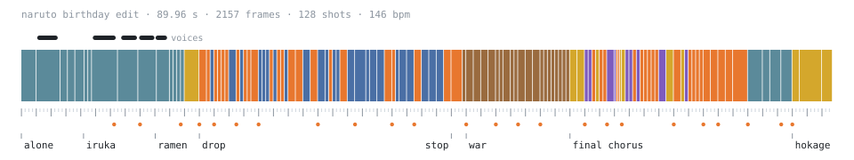

<div align="center">

# amv

<a href="https://pub-0247c5607054404c8af5064f866a4233.r2.dev/naruto/naruto_bday_edit_v2.mp4">
  <picture>
    <source media="(prefers-color-scheme: dark)" srcset=".github/timeline-dark.svg">
    
  </picture>
</a>

<br>

Anime edits written in Python.<br>
Every frame is built in numpy, cut on the beat and piped to ffmpeg.

[watch the edit](https://pub-0247c5607054404c8af5064f866a4233.r2.dev/naruto/naruto_bday_edit_v2.mp4) · [install](#install) · [render](#render-the-naruto-edit) · [effects](#effects) · [contributing](CONTRIBUTING.md)

[](https://github.com/bas3line)
[](https://github.com/bas3line/amv/actions/workflows/ci.yml)
[](LICENSE)
[](requirements.txt)

</div>

<br>

Written in Python by [@bas3line](https://github.com/bas3line). The first edit is a Naruto birthday edit for 10.10, cut to "Jane!" by The Long Faces: 1:30 at 1080p, 128 shots, and every cut lands on a beat frame. There is no editor timeline. [`director.py`](director.py) is the timeline: one line a shot, rendered frame by frame.

The story runs alone, Iruka, the ramen vow, then the drop: Haku, Neji, Gaara, Sasuke, Pain, Kurama, the war, the last Valley of the End, and the Hokage. The original voices (English dub) carry the story part, with the song ducked under them.

## How it works

- `song/song.json` is the beat map: a 146 BPM grid fitted on the drum stem, the bars, the sections, the accent hits, and the two song segments the edit is spliced from.
- `director.py` is the edit. Each shot is `S(beat, clip, source_time, act, **effects)`. A shot starts on frame `round(t * 24000/1001)` of its beat. Every output frame is composited in numpy and OpenCV, six lossless chunks render in parallel, and ffmpeg joins them and muxes the audio.
- `fx/` holds the effects: `fxpack.py` is the base camera, grade and transition kit, `refpack_A.py` and `refpack_B.py` are moves measured frame by frame on reference edits, `titles.py` is the type, and `credits.py` is the end-card row.
- `voices/mix.py` cuts the dialogue lines from their clips' demucs vocal stems, places each one so it stays lip-synced to its shot, and ducks the song's vocals and accompaniment under it. Outside the duck windows `mix.wav` keeps the song's original samples.
- `tools/sr.py` runs Real-ESRGAN (realesr-animevideov3) on the soft SD plates, and `tools/flash.py` counts flashes per second on a render, for photosensitivity.

## Install

You need Python 3.12 and ffmpeg.

```sh
git clone https://github.com/bas3line/amv
cd amv
python3.12 -m venv .venv && . .venv/bin/activate
pip install -r requirements.txt
pip install -r requirements-ml.txt   # optional: torch + demucs, for voices/mix.py and director.py --sr
```

## Render the Naruto edit

The repository holds code and data, never media. Bring your own:

- **Footage.** `footage/<clip>.mp4`: 1080p clips at their native frame rate, with logos removed and no crop. `footage/*_shots.json` lists every clip the edit reads, with where it came from and how it was normalised.
- **Song.** `song/edit.wav`: the song cut to the two segments in `song/song.json` (`segments` and `splices`), 44.1 kHz stereo.
- **Weights.** `models/realesr-animevideov3.pth` from the [Real-ESRGAN v0.2.5.0 release](https://github.com/xinntao/Real-ESRGAN/releases/tag/v0.2.5.0).

Then:

```sh
python voices/mix.py            # song + the dialogue lines -> voices/mix.wav
python director.py --sr         # Real-ESRGAN plates -> sr_cache/ (once)
python director.py              # -> out/naruto_bday_edit.mp4
```

A full render takes about 2.5 minutes (141 s on a 10-core Apple M4), and two renders come out byte-identical. To check a few frames without rendering, `python director.py --stills 0,473,2150` writes PNGs to `dir_tmp/stills/`.

## Effects

Every effect takes and returns a 1920x1080 BGR frame, and all randomness is seeded, so a render is repeatable frame for frame.

| effect | what it does |
| --- | --- |
| `refpack_B.impact_cut` | the 5-frame impact transition: a zoom smear out, a negative glow frame, an ink page and a radial entry |
| `refpack_A.drop_frame` | the drop: zoom-blur entry, big shake, echo trail and a decaying glow |
| `refpack_A.smear_whip` | a 2-frame motion-blur whip between shots |
| `refpack_A.impact_shake` | an alternating jolt after a hit, overscaled so no edge ever shows |
| `refpack_B.beat_smear` | a jolt and smear on a beat inside a held shot |
| `refpack_B.card_swing` | a held shot as a 3D card swinging in |
| `refpack_B.duotone_hit` | a two-colour grade hit with an RGB split |
| `refpack_B.white_whip_in` | a near-white smear into the next shot |
| `refpack_A.zoom_entry`, `zoom_through` | radial zoom-blur in, or a punch through the subject into the cut |
| `refpack_A.light_sweep`, `soft_glow`, `duotone` | a light sweep, a bloom, and a gold or blue wash |
| `refpack_A.subtitle` | word-by-word subtitles under the voice lines |
| `v2fix.eye_trails` | glowing light trails out of the eyes |
| `v2fix.rgb_hit` | an RGB split decaying over 4 frames |
| `fxpack.slit_open` | the opening: a centre slit opening into a letterbox |

`python tests/test_smoke.py` runs all of them on a test card, with no footage needed.

## Contributing

Fixes, new effects and new edits are welcome. [CONTRIBUTING.md](CONTRIBUTING.md) covers the layout, the checks and how to open a pull request, and the [code of conduct](CODE_OF_CONDUCT.md) applies everywhere. Found a security problem? See [SECURITY.md](SECURITY.md).

## Author

Made by [@bas3line](https://github.com/bas3line). Follow on X as [@inlovewithgo](https://x.com/inlovewithgo) and on Instagram as [@rword_shubham](https://www.instagram.com/rword_shubham). If you use it, a link back is appreciated, and so is a star.

To support it: [GitHub Sponsors](https://github.com/sponsors/bas3line), [Buy Me a Coffee](https://buymeacoffee.com/bas3line) or [PayPal](https://paypal.me/ShubhamYadav886).

## License

The code is MIT, © [@bas3line](https://github.com/bas3line). The fonts in `fonts/` are under the SIL Open Font License; their licence files sit beside them. The logos in `fx/logos/` come from [Simple Icons](https://github.com/simple-icons/simple-icons) (CC0), and each is a trademark of its owner.

No footage or music is included. Naruto belongs to Masashi Kishimoto, Shueisha, TV Tokyo and Studio Pierrot, and "Jane!" belongs to The Long Faces.
